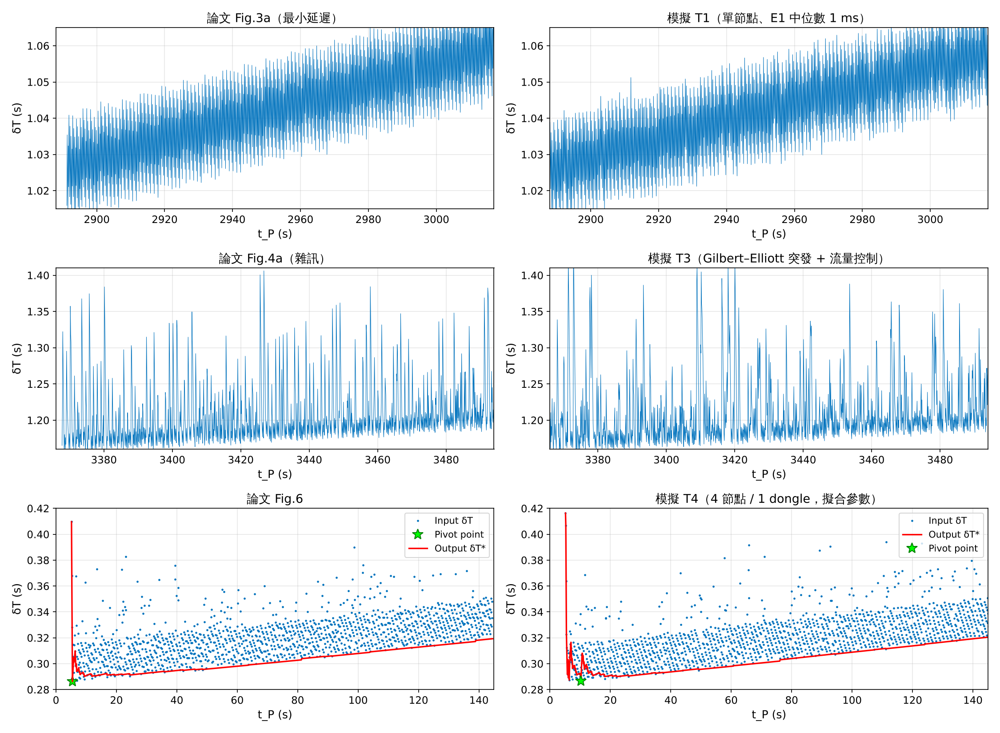

# 測試結果總表（T0–T9）

依《SharkTooth 復現模擬：延遲來源整理與測試規格》（`../docs/SharkTooth_模擬測試規格.md`）執行。每個測試的設定、表格與圖在各自資料夾的 `README.md`。
所有測試都是 ≥ 20 seeds（T1–T4 的擬合 / 掃描除外，見各 README）、3600 s。

**和論文相符那組設定的每個參數出處與合理性**：[provenance_paper_match.md](provenance_paper_match.md)。
**模擬變因總表（每個測試開了哪些變因）**：[variables_matrix.md](variables_matrix.md)。

## 一覽

| 測試 | 規格的通過標準 | 結果 | 一句話結論 |
|---|---|---|---|
| [T0](T0_digitize/README.md) 數位化 | 疊回原圖肉眼對齊 | ✔（直接讀 PDF 向量，刻度擬合殘差 ≈ 0） | 論文封包間隔是 **100.64–100.93 ms**，不是 100 ms；Fig.6 殘差 = 0–30 ms 均勻 + 30–60 ms 平台 |
| [T1](T1_fig3/README.md) Fig.3 | σ100 平均 14.3–14.7 ms；層數 / 峰對峰差 < 20 % | ✔（E1 中位數 0.2–2 ms 時 14.45–14.64 ms） | 最小延遲條件下 PC 端連續抖動只有約 1 ms |
| [T2](T2_gcd/README.md) gcd / 階梯 | （描述性） | 完成 | 階梯來自 P 與 CI 的公因數；**正的延遲抹不平下緣**；論文平滑是因為 100.93 ms |
| [T3](T3_fig4/README.md) Fig.4 | σ100 範圍 30–50 ms、尖峰分布 | ✔ σ100 35 ms（25–47）；P50/P90、>2CI、尖峰率在 10 % 內；P99 偏高（235 vs 187 ms） | 需要「突發」干擾（約 25 % 時間 PER ≈ 0.7、每次約 4 個 event） |
| [T4](T4_fig6/README.md) Fig.6 | P10/P50/P90 差 < 3 ms、P99 < 10 ms、離群 < 2 pp | ✔ 全部通過（5.0/18.3/31.8/61.4 vs 4.7/18.0/32.2/61.5 ms；離群 5.3 vs 4.9 %） | 四個特徵各有單一來源（見 [ablation_T4.md](ablation_T4.md)） |
| [T5](T5_warmup/README.md) 暖機 | （描述性） | 完成 | 暖機讓單節點第 1–3 段變大、節點對後段變大；**不能**解釋 Table II 第 1 段；λ = 0.9999 有幫助 |
| [T6](T6_tableII/README.md) Table II | 趨勢與量級 | ✔ 以 Fig.12 校正雜訊後**預測** Table II：全部 216 格 RMS 差 0.08 ms（穩態 0.05 ms） | 論文的 0.2–0.6 ms ≈ 同步誤差 + 量測雜訊 + 節點固定偏差；穩態 std 幾乎全是量測 |
| [T7](T7_integrity/README.md) 完整性 | （比較） | 完成 | 掉包無害；buffer 讀錯、重開機、溢位、**負漂移**會讓原版失效；§7 檢查 + 預傾斜可修 |
| [T8](T8_baselines/README.md) 基準方法 | （比較） | 完成（[baselines_T8.md](baselines_T8.md)） | 節點延遲相同時 OLS 就夠；**有一個節點比較吵時只有追下緣的方法撐得住** |
| [T9](T9_sensitivity/README.md) 參數 | （比較） | 完成 | γ1 增量最敏感，且綁定「封包率 × 漂移」；其他參數不敏感 |
| [T10](T10_drift_origin/README.md) 漂移來源 | （對照） | 完成 | **δT 的 +245 ppm 是設定進去的**：只留物理時鐘誤差時斜率 −63～+64 ppm、46 % 往下；往下的節點原版 82 % 壞輸出，預傾斜可修 |
| [T11](T11_drift_combos/README.md) 漂移來源的組合 | （對照） | 完成 | 110 種時鐘 / 時間戳誤差組合，五項檢查全過的只有兩類：**韌體換算用 30.51 µs**（+248 ppm）或 **晶振負載電容比規格多約 4 pF**（+232 ppm，需每腳外接約 12 pF，超過 Apollo3 允許的 7 pF）；RC 時鐘源、單靠 PC 時鐘、15.6 ms 的 time.time() 都排除 |
| [T11b](T11b_slope_likelihood/README.md) 哪個組合最像 | （對照） | 完成 | 用論文三個斜率（245 / 235 / 244 ppm）算各組合的似然：**30.51 µs 與每腳 12 pF 分不出來**（差不到兩倍）；照抄 15 pF、HFADJ＋不接電容、只靠 PC 時鐘明顯較差（三張圖來自不同節點時） |
| [T12](T12_temperature/README.md) 溫度與 t_P 解析度 | （對照） | 完成 | 加入晶振暖機＋室溫起伏、PC 時鐘溫度、ADC 計時器（RC）溫度：貼身時斜率 30 分鐘內升約 +1.5 ppm 後穩定，桌上幾乎不變，都比 +240 小兩個數量級，加了之後仍和論文相符；論文資料顯示 RC 計時器幾分鐘內變約 100 ppm、**t_P 是整數毫秒**（後者不影響同步） |
| [T13](T13_warmup_tableII/README.md) 暖機 vs Table II 第 1 段 | Table II、Fig.10–12 | 完成 | 第 1 段（前 10 分鐘）大、之後收斂，**不加暖機就做得出來**（SharkTooth 起始收斂）；桌上的暖機幾乎不改變任何數字；暖機大到看得出來（每節點 ±10 ppm）時是後段變大、不回落，和論文相反 → 論文資料把節點間的暖機限制在約 ±3 ppm 以內 |

## 最重要的發現（簡報用）

0. **T1 / T4 的「向上飄移」不是模擬推出來的（T10）**：+245 ppm 是設定檔手動放的 A8 = −248 ppm。拿掉之後，節點 ±20 ppm、PC ±50 ppm 的物理誤差只做得出 −63～+64 ppm，而且 46 % 的節點 δT 往下。簡報圖：`T10_drift_origin/slope_compare.png`、`T10_drift_origin/sharktooth_effect.png`。

1. **論文資料的封包間隔是 100.64–100.93 ms（T0）**。Fig.3、4、6 三張圖數位化後一致：取樣計時器比晶振慢 0.6–0.9 %【推測：ADC 計時器由 HFRC 衍生】。
   P mod CI ≈ 10.8 ms 讓等待時間在約 3 s 內掃過整個 CI → δT 是**連續**的 30 ms 帶、下緣平滑。
   上一版模擬「離散水平線、階梯下緣」的原因是用了剛好 100 ms（T2：階梯高度 = gcd(P, CI)，而且再大的正延遲都抹不平下緣）。
2. **Fig.6 不需要大的連續延遲（T4）**：帶寬 = 1 個 CI（等 connection event）；上方的稀疏點 = 重傳一次（約 8 % / 次嘗試）；
   起始尖峰 = 第一包多等約 100 ms；尖峰後每包 −40 ms 的斜坡 = **韌體流量控制：背壓時每 2 個 CI 才送一包**
   （100.7 − 60 = 40；論文 §IV-A 也寫封包週期至少要 2 × CI）。PC / USB / dongle / OS 合計只有約 1 ms。
3. **Fig.4 的雜訊是「突發」的（T3）**：獨立重傳只會讓帶子變厚；要做出 100–200 ms 的尖峰與 19 % 的點高於 2 CI，需要數個 event 長的壞通道狀態。
4. **Table II 可以被預測（T6）**：只用 Fig.12 的 σ²100 校正每個配置的連線失敗率，模擬就自然產生 Table II 的「節點越多、封包越長誤差越大」與「第 1 段大、之後收斂」。
   拆解後：
   - SharkTooth 自己的穩態同步誤差：2 節點約 0.1 ms，12 節點（最差一對）約 0.3–0.5 ms；
   - Table II 穩態的**標準差**（0.25–0.41 ms）幾乎全是量測雜訊（互相關 + ADC 雜訊），同步本身只貢獻 0.02–0.06 ms；
   - std 隨**封包長度**增加這件事，時間誤差做不出來，需要一個隨封包長度增加的量測誤差【推測：BLE 發射耦合進高增益 EMG 前端】；
   - Fig.10 收斂後各對 ±0.3 ms 的固定偏移，與每節點約 0.1 ms 的 AFE 群延遲差（30 Hz 高通元件誤差的量級）一致。
5. **SharkTooth 的弱點（T5、T7）**：δT 斜率為負時，每個新低點都觸發樞紐點重置，論文字面版 82 % 的時間沒有輸出。
   論文的斜率剛好都是 +235～+245 ppm（遠超 ±20 ppm 晶振，很像韌體 tick 換算常數造成，例如 1/32768 s 寫成 30.51 µs → −248 ppm），等於「天然預傾斜」。
   **修正：先把 δT 加上 +100 ppm 的已知斜率再跑、輸出時扣回**（一行），負漂移下 P95 回到 0.28 ms。
6. **重開機、計時器溢位、buffer 讀錯（50 Hz 時一個樣本 = 20 ms）會讓原版 SharkTooth 失效**；§7 的完整性檢查能 100 % 抓到並修正（T7）。掉包、斷線本身則完全無害。
7. **和先前方法比（T8）**：各節點延遲分布相同時，OLS 的截距誤差會在節點對之間抵消，簡單方法就有 0.17–0.3 ms；
   只要有一個節點比較吵，全部點 OLS / 視窗 OLS 就差到 7–9 ms、剔除離群 OLS 0.8–2 ms，**追下緣的方法（SharkTooth、下凸包 / LP、最小值濾波）維持在 0.5–1 ms**。
   SharkTooth 可以介紹成「線上、平滑化的下凸包」（Moon, Skelly, Towsley 1999 的 LP 下界法同源）。
8. **參數（T9）**：γ1 增量 1e-6 對論文自己的漂移（≈ 2.4e-4）偏小，1e-5 收斂更快；增量真正的意義是「每秒爬多少」，應該 ∝ 漂移 / 封包率。

## 交付物對照（規格 §9）

| 規格 | 檔案 |
|---|---|
| `results/<test>/`：圖、summary.json、結論 README | `T0_digitize/` … `T9_sensitivity/` |
| `results/fig_compare.png` | [fig_compare.png](fig_compare.png) |
| `results/ablation_T4.md` | [ablation_T4.md](ablation_T4.md) |
| `results/baselines_T8.md` | [baselines_T8.md](baselines_T8.md) |
| 簡報用圖（與論文相同座標、字體 ≥ 12 pt） | `fig_compare.png`、`T1_fig3/fig3_compare.png`、`T3_fig4/fig4_compare.png`、`T4_fig6/fig6_compare.png`、`T6_tableII/fig10_compare.png`、`T6_tableII/fig11_compare.png`、`T6_tableII/fig12_compare.png` |

## 與規格不同的地方（請注意）

- **封包間隔**：規格與上一版都假設 100 ms；T0 量到 100.64–100.93 ms，T1 之後的設定都用量到的值（並在 T2 / T4 消融中對照 100 ms）。
  規格 T1 的「鋸齒週期應為 0.3 s、理論 σ 14.14 ms」因此改為 0.277 s、14.44 ms。
- **新增模組**：ADC 計時器時鐘（`clock_adc`）、韌體流量控制（`flow`：window / ack 延遲）。兩者都是為了解釋 T0 量到的特徵而加的，標為【推測】。
- **互相關的正負號**：論文沒寫 lag 的約定；照字面 τ̂ − τ 會變成兩倍而非相消，所以取讓兩者同號的約定（以「完美時間戳 → RSE ≈ 0」驗證）。
- **互相關的實作**：用「5 Hz 的 DFT 相位 + 0.1 ms 量化」取代逐 lag 計算（數學等價、`tests/` 有比對），否則 T6 要跑數小時。
- **T3**：規格的格點太粗（最佳 σ100 只有 31 ms），另外在附近做了隨機搜尋；兩者都列在 README。
- **T4**：δT 斜率用 A8（−248 ppm）+ A1（±20 ppm）產生，而不是單純「固定 ρ」，因為 ±20 ppm 晶振做不出 245 ppm。
- **T5**：A8 用 0 / −248 ppm（−248 是對論文斜率的具體候選），不是 0 / 200 ppm。
- **T6**：規格說「每節點加入固定偏差」；這裡分成 V1–V4 四個量測模型逐步加入，才看得出各自的貢獻。V4 的兩個參數是在穩態段落格點擬合的（假說，不是預測）。
- **T9 的封包率測試**：20 Hz 超過「每 2 個 CI 一包」的流量上限，所以該組用 window = 2。

## 待確認（規格 §10，模擬的結論依賴這些）

- 取樣計時器用哪個時鐘源？若真的是 HFRC，封包間隔會隨溫度變 → 會影響 P/CI 相位。
- 韌體是否「等上一包 TX 完成才放下一包」？（決定流量控制模型）
- t_P 的 tick → 時間換算常數？（決定 δT 斜率的正負；斜率 < 0 時 SharkTooth 需要預傾斜）
- 實測的 Fig.12 式 σ²100 與封包長度的關係、ADC 雜訊是否隨封包長度增加。
