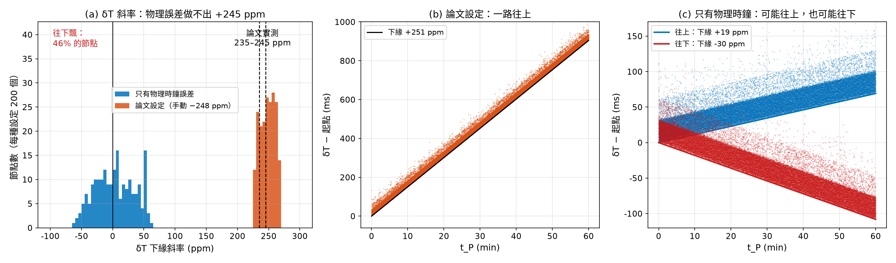
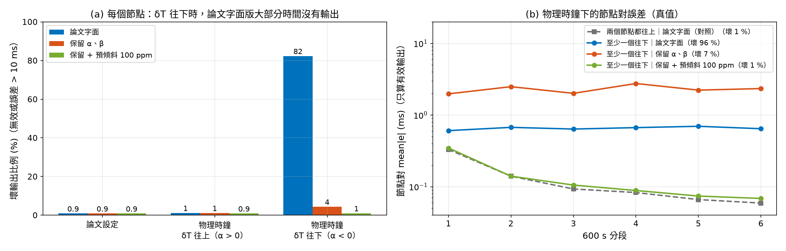

# T10　δT 的向上飄移從哪來

**問題**：論文 Fig.3 / 4 / 6 的 δT 下緣斜率都是 +235～+245 ppm（T0）。T1 / T4 能做出一樣的圖，是因為設定檔**手動**放了
A8 = −248 ppm（`T4_fig6.yaml`）或 ρ = −245 ppm（`T1_fig3.yaml`），而且把 PC 時鐘設成理想。這個測試把這兩個設定拿掉，看 δT 會不會自己往上飄。

**設定**（`config/T10_drift_origin.yaml`）：T4 擬合出的延遲參數、4 節點 / 1 dongle、3600 s × 50 seeds（共 200 個節點 / 每種設定）。兩種時鐘設定：

- **論文設定**：節點晶振 ±20 ppm（均勻）＋ A8 = −248 ppm，PC 時鐘理想（= T4）。
- **只有物理時鐘誤差**：節點晶振 ±20 ppm（論文的 ABS04W 規格）、PC 時鐘 ±50 ppm（均勻）、A8 = 0。

δT 斜率用「每 10 s 取最小值 → LP 下緣線」量（與 T0 量論文圖的方法相同）；量到的值與真值差中位數 -0.01 ppm。

## 1. δT 斜率

| 設定 | 節點數 | 最小 / 中位數 / 最大 (ppm) | 5–95 % | δT 往下（α < 0） | 落在論文範圍 ±5 ppm |
|---|---|---|---|---|---|
| 論文設定（A8 = −248 ppm、PC 理想） | 200 | +229 / +249 / +268 | +230 ～ +266 | 0% | 47% |
| 只有物理時鐘誤差（節點 ±20、PC ±50 ppm） | 200 | -63 / +4 / +64 | -45 ～ +53 | 46% | 0% |

## 2. 對 SharkTooth 的影響

每個節點（中位數）：**樞紐點數 / 壞輸出比例（無效或真值誤差扣常數後 > 10 ms）/ 好輸出的誤差 P95 (ms)**。
「保留 α、β」= 穩定期內沿用上一組 α、β（論文字面是輸出 α = β = 0）；「預傾斜」= T7e 的修正，先把 δT 加上 +100 ppm 再跑、輸出時扣回。

| 群組 | 節點數 | 論文字面 | 保留 α、β | 保留 + 預傾斜 100 ppm |
|---|---|---|---|---|
| 論文設定 | 200 | 8 / 0.9 % / 0.33 | 8 / 0.9 % / 0.33 | 8 / 0.9 % / 0.34 |
| 物理時鐘，δT 往上（α > 0） | 108 | 9 / 1.2 % / 0.29 | 9 / 1.2 % / 0.29 | 8 / 0.9 % / 0.29 |
| 物理時鐘，δT 往下（α < 0） | 92 | 190 / 82.4 % / 0.88 | 190 / 4.4 % / 5.36 | 8 / 1.0 % / 0.32 |

節點對（論文 RSE 量的東西，不扣常數）：各段 mean|e_nm| (ms)，第 1–6 段，只算兩邊都有效的輸出；括號內是壞輸出比例。

| 群組 | 節點對數 | 論文字面 | 保留 α、β | 保留 + 預傾斜 100 ppm |
|---|---|---|---|---|
| 論文設定 | 300 | 0.38 / 0.18 / 0.14 / 0.10 / 0.09 / 0.07（壞 1 %） | 0.38 / 0.18 / 0.14 / 0.10 / 0.09 / 0.07（壞 1 %） | 0.41 / 0.19 / 0.14 / 0.11 / 0.09 / 0.08（壞 1 %） |
| 物理時鐘，兩個節點都往上 | 141 | 0.33 / 0.14 / 0.09 / 0.08 / 0.07 / 0.06（壞 1 %） | 0.35 / 0.14 / 0.09 / 0.08 / 0.07 / 0.06（壞 1 %） | 0.33 / 0.14 / 0.10 / 0.08 / 0.07 / 0.06（壞 1 %） |
| 物理時鐘，至少一個往下 | 159 | 0.61 / 0.67 / 0.64 / 0.67 / 0.70 / 0.64（壞 96 %） | 1.98 / 2.49 / 2.01 / 2.76 / 2.23 / 2.34（壞 7 %） | 0.35 / 0.14 / 0.11 / 0.09 / 0.07 / 0.07（壞 1 %） |

## 結論

1. **物理時鐘誤差做不出論文的向上飄移。** 只留晶振與 PC 時鐘誤差時，δT 斜率在 -63～+64 ppm（中位數 +4），
   落在論文 235–245 ppm 附近的比例是 0%；而且 **46% 的節點 δT 是往下走的**。
   論文那條 +245 ppm 需要一個「所有節點共有、約 −248 ppm」的額外因素。T1 / T4 的圖之所以對得上，是因為這個值是設定進去的，不是模擬推出來的。
2. **這個斜率的來源論文沒有說明。** 候選：(a) 韌體把 tick 換成時間時用 30.51 µs（正確值 1/32768 = 30.5176 µs，剛好 −248 ppm）；
   (b) PC 時鐘快 245 ppm（一天快 21 s，不太合理）；(c) 時間戳不是用 32.768 kHz 晶振打的（但論文 §II-A 明寫晶振是 time source）。三個都**未驗證**。
3. **斜率的正負對 SharkTooth 影響很大。** δT 往上的節點，論文字面版壞輸出只有 1.2 %（樞紐點 9 個）；
   往下的節點壞輸出 82 %（樞紐點 190 個）：每個新低點都變成新樞紐點、迴歸一直被清空。
   只「保留 α、β」能把無效輸出補起來，但輸出的是過時的 α、β（壞輸出 4 %，好輸出的 P95 卻變成 5.36 ms）；
   **預傾斜 +100 ppm 讓往下的節點回到 1.0 %、P95 0.32 ms**，和往上的節點一樣。
   節點對：含往下節點的對，第 6 段 mean|e| 從 0.64（壞 96 %）降到 0.07 ms（壞 1 %）。
4. **論文的系統剛好有一個天然的預傾斜。** 換成一般開發板（沒有那個 −248 ppm），大約 46% 的節點會碰到這個問題。
   所以開發板實測時，**第一個要量的就是 δT 斜率的正負**；如果是負的，SharkTooth 要先加預傾斜。

## 開發板實測時的預測（實測前寫下）

| 量到的 δT 斜率 | 代表 |
|---|---|
| 幾十 ppm 以內，各板正負不一 | 和本測試的「物理時鐘」一致；論文的 +245 ppm 是他們系統特有的 |
| 約 +248 ppm | 韌體用了類似 30.51 µs 的換算常數（可直接檢查程式碼） |
| 其他很大的值（> 100 ppm） | 時間戳的時鐘源不是 32.768 kHz 晶振，或 PC 時鐘有問題 |

PC 端時間戳的時鐘源也會直接改變斜率：Windows `time.perf_counter()`（QPC）與 Linux `CLOCK_MONOTONIC`（受 NTP 調速）不同，實測時要記下用的是哪一個。
