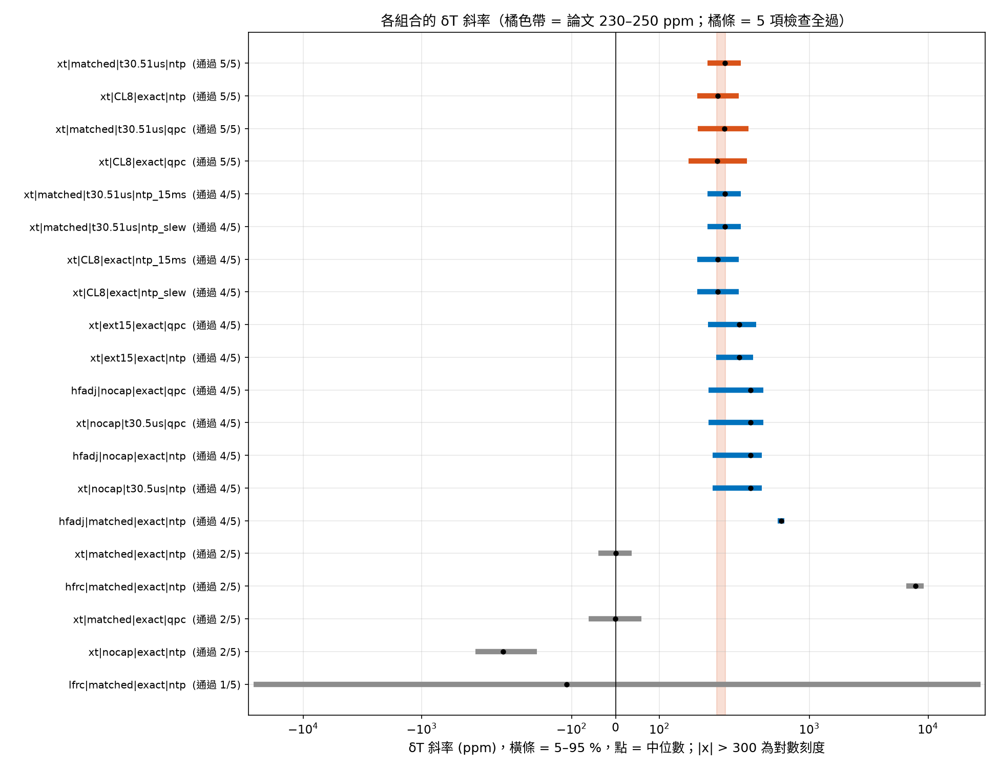
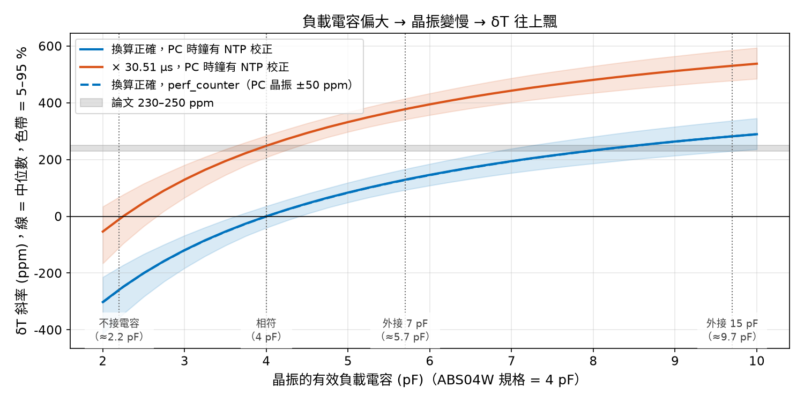

# T11　哪些誤差組合做得出論文的 δT（向上飄移）

**目的**：T10 證明「只有晶振 ±20 ppm + PC ±50 ppm」做不出論文 +230～+250 ppm 的斜率。這裡把找得到的候選誤差全部放進來、
做所有組合，看哪些組合同時對上論文的多項觀察。

**時鐘誤差是固定值**：每個節點的時鐘誤差（ρ）在一次 1 小時擷取內是常數；隨機的只有「抽到哪一顆晶振、哪一塊板子、哪一台 PC」。
（例外是刻意設成會變的因素：NTP 調速。溫度：ABS04W 的溫度係數約 −0.034 ppm/°C²，麵包板上 23→33 °C 只差 < 2 ppm，所以沒有列為因素。）

## 1. 候選因素

| 因素 | 水準 | 根據 |
|---|---|---|
| t_P 的時鐘源 | 32.768 kHz 晶振 / HFRC 鎖晶振（HFADJ，-576 ppm，規格書 §12.1.5：HFXTADJ = 1464）/ HFRC（RC，和 ADC 同一顆）/ LFRC（RC，±3 % 假設） | 論文 §II-A：晶振是時間戳的時鐘源；使用者問是否其實是 RC |
| 晶振有效負載電容 | 不接電容 ≈2.2 / 相符 4 / 外接 7 pF ≈5.7 / ≈8 / 外接 15 pF ≈9.7 pF | ABS04W：規格負載 4 pF、C0 1.5–2.0 pF、C1 6.5 fF、靈敏度 −90～−125 ppm/pF；Apollo3 每腳內建 3.4 pF、允許外加 ≤ 7 pF；SparkFun 論壇實測 Apollo3 換負載電容後誤差 +12 / +69 / +347 ppm |
| 韌體 tick → 時間換算 | 正確 / × 30.51 µs（−248 ppm）/ × 30.5 µs（−576 ppm） | 4 B 時間戳若以 µs 存，要做這個換算 |
| PC 時鐘（t_C） | NTP 校正 / 同左但 15.6 ms 解析度 / perf_counter ±50 ppm / NTP 調速 / 很差 ±300 ppm | pc-ble-driver-py 只支援 Python < 3.11；Windows 上 Python < 3.13 的 time.time() 解析度約 15.6 ms |

負載電容造成的頻率偏移：Δf/f = (C1/2)·[1/(C0 + CL_有效) − 1/(C0 + 4 pF)]，每塊板子的 C0、C1、雜散電容各自抽樣。
其他固定條件：T4 擬合的 BLE 延遲參數、4 節點 / 1 dongle、244 B、3600 s × 8 seeds。ADC 計時器誤差 6400–9300 ppm（T0 由封包間隔反推）。

## 2. 五項檢查（對照論文）

1. **斜率**：解析抽樣 20000 次，斜率中位數落在 230–250 ppm。另外列出「單一節點落在範圍內的機率 p」；論文三張圖都落在範圍內，若三張來自不同節點，機率約 p³
2. **沒有往下的節點**：δT 往下的比例 ≤ 1 %（論文沒有出現 SharkTooth 失效）
3. **封包間隔**（以 t_P 計）在 100.6–101.0 ms
4. **殘差分布**（Fig.6 時間窗，對下緣線）：P50 = 18.0 ± 3 ms、P90 = 32.2 ± 4 ms
5. **SharkTooth（論文字面版）能用**：壞輸出 > 5 % 的節點 ≤ 10 %，第 6 段節點對 mean|e| ≤ 1 ms（論文 C4 = 0.35 ms）

## 3. 結果：前 15 名組合

| # | t_P 時鐘源 | 負載電容 | 換算 | PC 時鐘 | 斜率 ppm 中位（5–95 %） | 落在論文範圍 | 往下 | 封包間隔 ms | 殘差 P50 / P90 ms | 壞輸出 > 5 % 的節點 | 第 6 段 ms | 檢查 1–5 |
|---|---|---|---|---|---|---|---|---|---|---|---|---|
| 1 | 32.768 kHz 晶振（論文寫的） | 相符（4 pF） | × 30.51 µs | PC 時鐘有 NTP 校正 | +248（+209 ～ +285） | 31% | 0% | 100.76 | 17.6 / 31.3 | 0% | 0.08 | ✓✓✓✓✓ |
| 2 | 32.768 kHz 晶振（論文寫的） | ≈8 pF（外接約 12 pF） | 換算正確 | PC 時鐘有 NTP 校正 | +232（+186 ～ +280） | 26% | 0% | 100.77 | 17.6 / 31.3 | 0% | 0.08 | ✓✓✓✓✓ |
| 3 | 32.768 kHz 晶振（論文寫的） | 相符（4 pF） | × 30.51 µs | perf_counter（PC 晶振 ±50 ppm） | +247（+187 ～ +307） | 20% | 0% | 100.76 | 17.6 / 31.3 | 0% | 0.08 | ✓✓✓✓✓ |
| 4 | 32.768 kHz 晶振（論文寫的） | ≈8 pF（外接約 12 pF） | 換算正確 | perf_counter（PC 晶振 ±50 ppm） | +231（+166 ～ +299） | 18% | 0% | 100.77 | 17.6 / 31.3 | 0% | 0.08 | ✓✓✓✓✓ |
| 5 | 32.768 kHz 晶振（論文寫的） | 相符（4 pF） | × 30.51 µs | 同左，但 time.time() 15.6 ms 解析度 | +248（+209 ～ +285） | 31% | 0% | 100.76 | 23.9 / 40.6 | 0% | 0.44 | ✓✓✓✗✓ |
| 6 | 32.768 kHz 晶振（論文寫的） | 相符（4 pF） | × 30.51 µs | NTP / w32time 調速 | +248（+209 ～ +285） | 31% | 0% | 100.76 | 17.6 / 31.3 | 75% | 0.08 | ✓✓✓✓✗ |
| 7 | 32.768 kHz 晶振（論文寫的） | ≈8 pF（外接約 12 pF） | 換算正確 | 同左，但 time.time() 15.6 ms 解析度 | +232（+186 ～ +280） | 26% | 0% | 100.77 | 23.9 / 40.6 | 0% | 0.33 | ✓✓✓✗✓ |
| 8 | 32.768 kHz 晶振（論文寫的） | ≈8 pF（外接約 12 pF） | 換算正確 | NTP / w32time 調速 | +232（+186 ～ +280） | 26% | 0% | 100.77 | 17.6 / 31.3 | 75% | 0.08 | ✓✓✓✓✗ |
| 9 | 32.768 kHz 晶振（論文寫的） | 外接 15 pF（≈9.7 pF） | 換算正確 | perf_counter（PC 晶振 ±50 ppm） | +281（+210 ～ +354） | 12% | 0% | 100.76 | 17.6 / 31.3 | 0% | 0.08 | ✗✓✓✓✓ |
| 10 | 32.768 kHz 晶振（論文寫的） | 外接 15 pF（≈9.7 pF） | 換算正確 | PC 時鐘有 NTP 校正 | +282（+229 ～ +336） | 11% | 0% | 100.76 | 17.6 / 31.3 | 0% | 0.08 | ✗✓✓✓✓ |
| 11 | HFRC 鎖在晶振（HFADJ） | 不接電容（≈2.2 pF） | 換算正確 | perf_counter（PC 晶振 ±50 ppm） | +317（+211 ～ +409） | 6% | 0% | 100.75 | 17.6 / 31.3 | 0% | 0.09 | ✗✓✓✓✓ |
| 12 | 32.768 kHz 晶振（論文寫的） | 不接電容（≈2.2 pF） | × 30.5 µs | perf_counter（PC 晶振 ±50 ppm） | +317（+212 ～ +409） | 6% | 0% | 100.75 | 17.6 / 31.3 | 0% | 0.09 | ✗✓✓✓✓ |
| 13 | HFRC 鎖在晶振（HFADJ） | 不接電容（≈2.2 pF） | 換算正確 | PC 時鐘有 NTP 校正 | +319（+221 ～ +397） | 5% | 0% | 100.75 | 17.6 / 31.3 | 0% | 0.09 | ✗✓✓✓✓ |
| 14 | 32.768 kHz 晶振（論文寫的） | 不接電容（≈2.2 pF） | × 30.5 µs | PC 時鐘有 NTP 校正 | +320（+221 ～ +397） | 5% | 0% | 100.75 | 17.6 / 31.3 | 0% | 0.09 | ✗✓✓✓✓ |
| 15 | 32.768 kHz 晶振（論文寫的） | ≈8 pF（外接約 12 pF） | × 30.51 µs | PC 時鐘很差（±300 ppm） | +477（+208 ～ +753） | 3% | 0% | 100.74 | 17.6 / 31.3 | 3% | 0.10 | ✗✓✓✓✓ |

五項全過的組合：4 個（共 110 個）。

## 4. 各因素水準：最好能做到幾項

| 因素 | 水準 | 最多通過 | 該組合落在論文範圍 | 有沒有五項全過的組合 | 最佳組合 |
|---|---|---|---|---|---|
| src | hfadj | 4/5 | 6% | 沒有 | `hfadj|nocap|exact|qpc` |
| src | hfrc | 2/5 | 0% | 沒有 | `hfrc|matched|exact|pc_bad` |
| src | lfrc | 1/5 | 0% | 沒有 | `lfrc|matched|exact|qpc` |
| src | xt | 5/5 | 31% | 有 | `xt|matched|t30.51us|ntp` |
| pull | CL8 | 5/5 | 26% | 有 | `xt|CL8|exact|ntp` |
| pull | ext15 | 4/5 | 12% | 沒有 | `xt|ext15|exact|qpc` |
| pull | ext7 | 4/5 | 3% | 沒有 | `xt|ext7|t30.51us|pc_bad` |
| pull | matched | 5/5 | 31% | 有 | `xt|matched|t30.51us|ntp` |
| pull | nocap | 4/5 | 6% | 沒有 | `hfadj|nocap|exact|qpc` |
| conv | exact | 5/5 | 26% | 有 | `xt|CL8|exact|ntp` |
| conv | t30.51us | 5/5 | 31% | 有 | `xt|matched|t30.51us|ntp` |
| conv | t30.5us | 4/5 | 6% | 沒有 | `xt|nocap|t30.5us|qpc` |
| pc | ntp | 5/5 | 31% | 有 | `xt|matched|t30.51us|ntp` |
| pc | ntp_15ms | 4/5 | 31% | 沒有 | `xt|matched|t30.51us|ntp_15ms` |
| pc | ntp_slew | 4/5 | 31% | 沒有 | `xt|matched|t30.51us|ntp_slew` |
| pc | pc_bad | 4/5 | 3% | 沒有 | `xt|CL8|t30.51us|pc_bad` |
| pc | qpc | 5/5 | 20% | 有 | `xt|matched|t30.51us|qpc` |

## 5. t_C 解析度（Fig.3 的乾淨通道，T1 設定，5 seeds × 600 s）

| t_C 解析度 | σ100 (ms) | 每包下降 (ms) |
|---|---|---|
| 1 µs | 14.47 | -10.90 |
| 15.625 ms（Windows time.time()，Python < 3.13） | 15.95 | -7.17 |
| 論文 Fig.3 | 14.23–14.75 | −10.90 |

## 6. 結論

1. **RC 振盪器當 t_P 時鐘源：排除。** HFRC 會讓 δT 斜率約 +7000～+9000 ppm，而且封包間隔剛好 100.00 ms（和 ADC 同一顆振盪器）；
   LFRC 則是 ±數萬 ppm、正負都有。論文是 +235～+245 ppm、封包間隔 100.6–100.9 ms。
   但**ADC 取樣計時器很可能是 RC**：封包間隔慢 0.6–0.9 %，而且每張圖不一樣，符合每顆晶片不同的 RC 誤差（規格書 §12.1.5：HFRC 典型變異 ±2 %；§18.2.3：ADC 重複觸發只能用 CTIMER 3，CTIMER 可選 HFRC 分頻）。
2. **只有兩類組合五項全過**（PC 時鐘用 NTP 校正或 perf_counter 都可以）：
   - **(a) 韌體把 tick 換成時間時用了 30.51 µs**（負載電容剛好相符）：斜率中位數 +248 ppm；
   - **(b) 晶振的負載電容比規格大約 4 pF**（4 pF 晶振實際接到約 8 pF，例如每腳外接約 12 pF）：斜率中位數 +232 ppm。
     如果照抄 SparkFun Artemis 的參考設計（每腳 15 pF，那是給 12.5 pF 晶振用的），斜率約 +282 ppm，稍微偏大但在同一個量級。
   兩者都是「所有節點共有的固定誤差」，所以每個節點都往上、SharkTooth 不會失效——正好是論文看到的。
3. **單靠 PC 時鐘做不出來**：PC 時鐘很差（±300 ppm）時，斜率剛好在論文範圍的機率只有約 3 %，而且一半的節點往下。
4. **論文的 t_C 不是 15.6 ms 解析度**：Windows 上 Python < 3.13 的 time.time() 會讓 Fig.6 的殘差 P50 / P90 變成約 24 / 41 ms
   （論文 18 / 32 ms），Fig.3 的 σ100 變成約 16 ms（論文 14.2–14.8 ms）。所以作者用的應該是 perf_counter 或 Linux。
5. **PC 時鐘在擷取中被 NTP 調速會讓 SharkTooth 失效**（壞輸出 > 5 % 的節點達 75 %）：調速期間 δT 的斜率暫時改變，觸發大量樞紐點。
   論文沒有這種失效 → 擷取期間 PC 時鐘沒有被調速（或用的是不受 NTP 影響的 perf_counter）。這個調速模型是假設的。
6. **溫度、老化**：ABS04W 約 −0.034 ppm/°C²，麵包板上 < 2 ppm；老化每年約 ±3 ppm。都可以忽略。

**限制**：(a)、(b) 都只是「做得出論文現象」，不代表就是原因。負載電容的 C0、C1 用的是規格書典型值，板與板差異是假設；
HFADJ 的目標值已由 Apollo3 規格書 §12.1.5 確認（1464）；LFRC 精度規格書沒給、NTP 調速的大小沒查到原始數字。(b) 需要每腳外接約 12 pF，超過 Apollo3 規格書允許的 7 pF（Table 1147），但 SparkFun 自己的參考設計就用 15 pF，有照抄的前例。負載電容模型用 SparkFun 論壇的三組實測（12.5 pF 晶振接 15 pF / 7.5 pF / 不接：+12 / +69 / +347 ppm）檢驗，模型給 +10～13 / +86～95 / +339～343 ppm，量級與方向對。ABS04W 的「K」字尾我推測是 4 pF（同家 ABS05W-…-K-2-T 是 4 pF），沒有直接查到。

## 7. 開發板實測時怎麼分辨

| 檢查 | 方法 | (a) 換算常數 | (b) 負載電容 | PC 時鐘 |
|---|---|---|---|---|
| 讀原始 tick | 韌體直接送 32.768 kHz 計數值，自己在 PC 端換算 | 斜率變回約 0 | 不變 | 不變 |
| 量晶振頻率 | CLKOUT 接頻率計（論壇做法），或換負載電容 | 正確 | 慢約 240 ppm | 正確 |
| 換一台 PC | 同一塊板子接另一台電腦 | 不變 | 不變 | 改變 |
| 看斜率的分散 | 多塊板子同時量 | 約 ±20 ppm | 約 ±30–50 ppm（C1 差異放大） | 同一台 PC 上所有板子一起變 |
