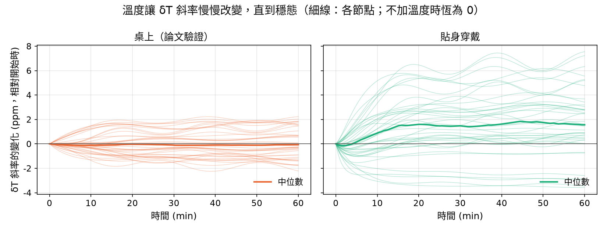
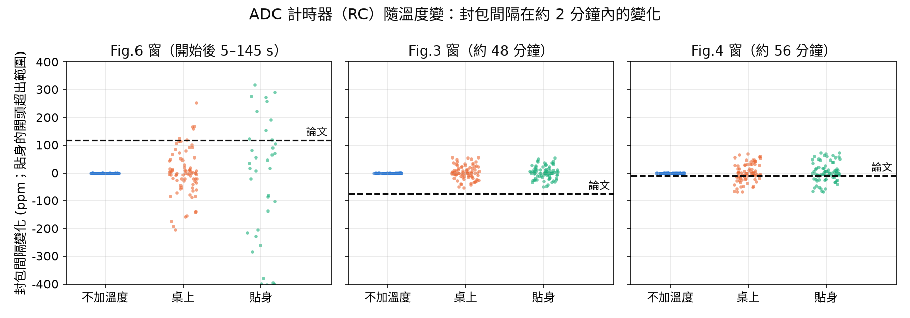
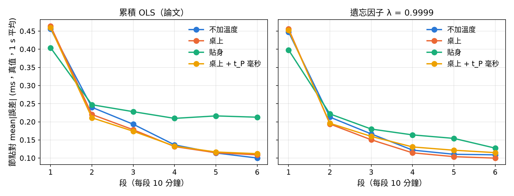

# T12　溫度造成的漂移（晶振暖機、PC 時鐘、ADC 計時器）與 t_P 解析度

**設定**（`config/T12_temperature.yaml`）：和論文相符的設定（T4 擬合的延遲參數 + T11 組合 (a)），只改溫度（和 t_P 解析度）。
4 節點 × 20 seeds × 3600 s。
同一個房間的室溫、空調起伏所有節點和 PC 共用；自熱、暖機快慢每個節點各自抽。

## 加入的物理因素與數值出處

| 因素 | 模型 | 數值 | 出處 |
|---|---|---|---|
| 節點晶振溫度（A2） | ρ = k (T − T0)² | k −0.04～−0.02 ppm/°C²、T0 20～30 °C | ABS04W 規格書 |
| 暖機（A3） | T(t) = T_end − (T_end − T_start)e^(−t/τ) | 桌上：自熱 +0.5～2 °C；貼身：升到 31～34 °C；τ 3～10 min | 自熱是假設（板子約 10–20 mW）；貼身裝置約 5–10 分鐘達穩態 |
| 環境溫度起伏 | ± A sin(2πt/P) | ±0.5 °C、週期 20～40 min | 假設（一般空調溫控） |
| PC 時鐘溫度（A6） | ρ = k1 (T − T_start) | k1 ±0.6 ppm/°C；CPU 負載升溫 1～5 °C、τ 5～20 min | Murdoch 2006：AT-cut 室溫附近約 0.5 ppm/°C，負載升溫 1–1.5 °C（Tor）／5 °C（CPUBurn），正負都有 |
| ADC 計時器溫度（B6） | 週期誤差 + tc (T − T_start) | tc ±300 ppm/°C | 48 MHz RC 全溫度範圍約 ±4 %（Microchip OSC48M）；Apollo3 規格書只說 HFRC 典型 ±2 % |
| t_P 解析度（A7） | 讀數無條件捨去到 1 ms | 1 ms（原本 1/32768 s） | 論文資料，見下表 |

## 論文資料裡的證據（由 T0 數位化的點直接量）

| 圖 | 封包間隔在圖內的變化 ppm（95 % CI） | 平均間隔 ms | 相鄰差落在整數 ms | 「較短那一格」比例 | 差超過 ±1 ms 的比例 |
|---|---|---|---|---|---|
| Fig.6（開始後 5–145 s） | +118（+113 ～ +123） | 100.776 | 49% | — | — |
| Fig.3（約 48 分鐘） | -76（-87 ～ -65） | 100.926 | 100% | 21.1%（純量化預期 7.4%） | 13.6% |
| Fig.4（約 56 分鐘） | -9（-21 ～ +3） | 100.646 | 100% | 35.4%（純量化預期 35.4%） | 0.5% |

- **封包間隔在幾分鐘內變了約 100 ppm**：晶振量的 t_P 只會差 < 1 ppm，所以這是取樣用的 RC 計時器在變，量級和「RC 隨溫度變」一致。
  Fig.6 是擷取剛開始：前 50 s 平，之後上升再趨平。
- **t_P 是整數毫秒**：Fig.3、Fig.4 的相鄰 t_P 差 100 % 是整數 ms。
  - 這不是數位化造成的：PDF 座標的最小單位換算是 0.70 ms，不會剛好落在 1.00 ms 的格點上。
  - Fig.4「100 ms 那一格」的比例和「只有量化」的預期一模一樣。
  - Fig.3 還有額外約 ±1 ms 的跳動（有 102 ms 的差），代表某些封包的 t_P 晚了 1 ms。
  - Fig.6 的點座標精度較差，看不清楚。
  - 韌體送出的是毫秒數，所以一定有一個 tick → ms 的換算（T11 的候選 (a) 就發生在這一步）。

## 1. δT 斜率隨時間的變化（相對開始時，ppm）

- 「節點 / PC」：60 分鐘後兩者各自造成的斜率變化（|ppm|，中位數）。
- 「從資料量到的」：最後 10 分鐘與最初 10 分鐘的下緣斜率差，也就是只看 δT 資料能量到的變化（中位數，括號 5–95 %）。

| 情境 | 1 / 5 / 10 / 30 / 60 min（中位數） | 60 min 時 5–95 % | 節點 / PC | 從資料量到的 |
|---|---|---|---|---|
| 不加溫度（目前的設定） | +0.00 / +0.00 / +0.00 / +0.00 / +0.00 | +0.0 ～ +0.0 | 0.00 / 0.00 | -0.3（-2.3 ～ +2.9） |
| 桌上（論文驗證） | -0.02 / -0.09 / -0.11 / -0.11 / -0.06 | -1.5 ～ +1.8 | 0.14 / 0.94 | +0.1（-2.9 ～ +2.8） |
| 貼身穿戴 | -0.12 / +0.15 / +0.88 / +1.48 / +1.56 | -2.9 ～ +5.7 | 1.59 / 0.94 | +1.3（-1.4 ～ +6.0） |

## 2. 和論文的比對（同 T11 的檢查）

| 情境 | 斜率 ppm 中位（5–95 %） | 落在 230–250 | 往下 | 封包間隔 ms | 殘差 P50 / P90 ms | SharkTooth 失效節點 | Fig.3 σ100 ms |
|---|---|---|---|---|---|---|---|
| 不加溫度（目前的設定） | +249（+230 ～ +266） | 44% | 0% | 100.75 | 17.8 / 31.3 | 0% | 14.48 |
| 桌上（論文驗證） | +251（+231 ～ +268） | 42% | 0% | 100.75 | 17.8 / 31.3 | 0% | 14.48 |
| 貼身穿戴 | +251（+232 ～ +268） | 45% | 0% | 100.77 | 17.7 / 31.3 | 0% | — |
| 桌上 + t_P 整數毫秒 | +251（+231 ～ +268） | 42% | 0% | 100.75 | 17.9 / 31.4 | 0% | 14.48 |
| **論文** | +235 ～ +245 | — | 0 % | 100.6–101.0 | 18.0 / 32.2 | 0 % | 14.23–14.75 |

## 3. 封包間隔在約 2 分鐘內的變化（|ppm|，各節點中位數；括號是 P90、以及 ≥ 論文值的節點比例）

| 情境 | Fig.6 窗（論文 +118） | Fig.3 窗（論文 -76） | Fig.4 窗（論文 -9） |
|---|---|---|---|
| 不加溫度（目前的設定） | 0（P90 0；0%） | 0（P90 0；0%） | 0（P90 0；0%） |
| 桌上（論文驗證） | 38（P90 154；16%） | 15（P90 42；0%） | 20（P90 55；68%） |
| 貼身穿戴 | 441（P90 1005；81%） | 12（P90 38；0%） | 17（P90 60；65%） |

## 4. SharkTooth 節點對誤差（真值，1 s 平均，各對平均，第 1–6 段，ms）

| 情境 | 累積 OLS（論文） | λ = 0.9999 |
|---|---|---|
| 不加溫度（目前的設定） | 0.46 / 0.24 / 0.19 / 0.14 / 0.11 / 0.10 | 0.45 / 0.21 / 0.17 / 0.12 / 0.11 / 0.11 |
| 桌上（論文驗證） | 0.46 / 0.22 / 0.18 / 0.13 / 0.11 / 0.11 | 0.46 / 0.19 / 0.15 / 0.11 / 0.10 / 0.10 |
| 貼身穿戴 | 0.40 / 0.25 / 0.23 / 0.21 / 0.22 / 0.21 | 0.40 / 0.22 / 0.18 / 0.16 / 0.15 / 0.13 |
| 桌上 + t_P 整數毫秒 | 0.46 / 0.21 / 0.17 / 0.13 / 0.12 / 0.11 | 0.45 / 0.20 / 0.16 / 0.13 / 0.12 / 0.12 |

## 結論

1. **貼身時看得到「斜率越來越大，直到穩態」**：
   - 中位數 10 分鐘 +0.9、30 分鐘 +1.5、60 分鐘 +1.6 ppm。
   - 主要來自節點晶振（60 分鐘時 1.6 ppm，PC 0.9 ppm）：皮膚溫度離晶振的轉折溫度遠，拋物線變陡。
   - 每個節點不一樣（5–95 %：-2.9 ～ +5.7），因為轉折溫度、係數、PC 的正負號都不同。
2. **桌上（論文的環境）幾乎沒有暖機曲線**：
   - 中位數 -0.06 ppm，5–95 % -1.5 ～ +1.8。
   - 節點晶振在轉折溫度附近幾乎不動（0.14 ppm），變化主要是 PC 升溫（0.94 ppm）和空調起伏，正負都有。
3. **兩種都比 +240 ppm 小兩個數量級。** 從 δT 資料本身量不太出來：不加溫度時，量到的變化就有 -2.3 ～ +2.9 ppm 的量測雜訊。
4. **加了溫度後仍然和論文相符**：
   - 斜率中位數 +249 → +251 ppm（桌上），差別在抽樣誤差內。
   - 殘差 P50 / P90、封包間隔、Fig.3 σ100、SharkTooth 失效節點都一樣（見第 2 節）。
   - 所以 T4 的擬合參數不用重調，T1–T11 的結論不變。
5. **ADC 計時器（RC）的溫度效應和論文資料的量級一致，但後段偏小**：
   - 桌上情境 Fig.6 窗：模擬中位數 38 ppm（P90 154），16% 的節點 ≥ 論文的 118 ppm。論文在偏高處，但在範圍內。
   - Fig.4 窗的 9 ppm 很普通（68% 的節點 ≥）。
   - Fig.3 窗的 76 ppm 只有 0% 的節點達到。論文後段 30 秒內就有數十 ppm 的起伏，比「溫度慢慢變」大。
     RC 振盪器本身還有和溫度無關的短期頻率起伏，這裡沒有建模，因為它不影響 δT 和同步結果。
   - 不加溫度時是 0。這個效應不影響 δT 斜率，只改變封包相位掃過 CI 的速度。
6. **t_P 整數毫秒幾乎沒有影響**：
   - 和論文的比對一樣（第 2 節）。
   - SharkTooth 節點對誤差第 2–6 段平均 0.15 → 0.15 ms。
   - 原因：封包間隔 100.x ms 不是整數毫秒，每包被捨去的量在 0–1 ms 之間輪流變化，1 s（10 包）平均後幾乎剛好是 0.5 ms。
     每個節點都一樣，所以兩兩相減就抵消了。
   - 反過來說，如果封包間隔剛好是整數毫秒（例如 100.000 ms），捨去量每包都一樣、不會抵消，就會留下最多 1 ms 的固定偏差。
7. **SharkTooth 和溫度**：
   - 桌上的節點對誤差和不加溫度時一樣（第 2–6 段平均 0.15 vs 0.16 ms）。
   - 貼身時後段變大（第 5–6 段 0.22 / 0.21 ms，不加溫度 0.11 / 0.10）：各節點升溫曲線不同，累積 OLS 把前期的彎曲留在斜率裡（和 T5 一樣）。
   - 遺忘因子 λ = 0.9999 降到 0.15 / 0.13 ms。

**限制**：
- 自熱的大小、空調起伏、RC 溫度係數的大小與正負號都是假設，或從其他晶片推的；PC 的溫度係數用的是 Murdoch 量的舊 PC。
- t_P 整數毫秒是從 Fig.3 / 4 看出來的，是「無條件捨去」還是「四捨五入」看不出來；這裡用捨去。
- 開發板上可以直接量：用 CLKOUT 量晶振、記錄封包間隔與板子溫度，就能把這些假設換成實測值。
