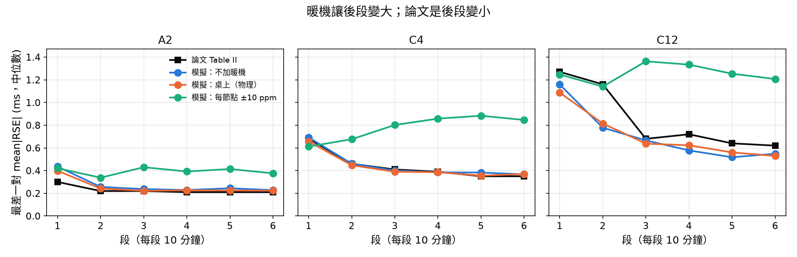
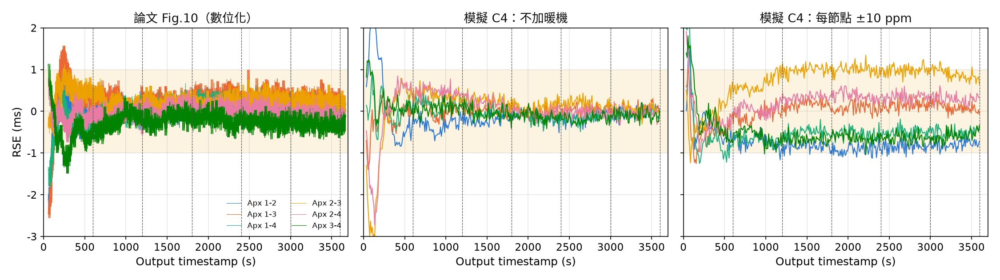

# T13　暖機能不能解釋 Table II / Fig.10–12「前 10 分鐘比較大」？

**問題**：論文 Table II、Fig.11–13 的第 1 段（前 10 分鐘）誤差都比後面大，之後收斂；Fig.10 各對 RSE 在前 10 分鐘慢慢移到穩定值。
這是晶振暖機（頻率還在變）造成的，還是 SharkTooth 本身的起始收斂？

**設定**（`config/T13_warmup_tableII.yaml`）：T6 的 18 個配置，完全沿用 T6 的校正（每個配置的連線失敗率、V4 量測模型），只在節點時鐘加暖機。
每個情境 × 配置跑 40 次 × 3600 s，取中位數（論文是 20 次的中位數）。

| 情境 | 節點頻率在暖機時怎麼變 |
|---|---|
| 不加暖機 | 不變（T6 的設定） |
| 桌上（物理模型） | T12 bench：ABS04W 拋物線、自熱 +0.5～2 °C、空調 ±0.5 °C，加 PC 與 ADC 計時器溫度 |
| 貼身（物理模型） | T12 body：升到皮膚溫度 31～34 °C |
| 每節點 ±3 / ±10 / ±30 ppm | 不管物理，每個節點的頻率在 τ = 3–10 min 內直接變 U(−X, +X) ppm，找「要多大才看得出來」 |

ABS04W（−0.034 ppm/°C²）從轉折溫度升溫 9 / 17 / 30 °C 才會變 3 / 10 / 30 ppm；桌上自熱只有 0.5–2 °C。

## 1. 第 1 段比第 2–6 段平均多多少（mean|RSE| / std，ms）

兩種原因的特徵不同。暖機在每個配置都一樣（同一張桌子、同一批板子）；SharkTooth 的收斂則是連線雜訊越大越慢，所以節點越多，第 1 段多出越多。

| | 2 節點（A2、B2、C2） | 12 節點 | 18 個配置平均 |
|---|---|---|---|
| **論文** | +0.13 / +0.17 | +0.31 / +0.69 | +0.21 / +0.42 |
| 不加暖機（T6） | +0.17 / +0.20 | +0.35 / +0.83 | +0.27 / +0.55 |
| 桌上（物理模型） | +0.15 / +0.19 | +0.31 / +0.79 | +0.25 / +0.53 |
| 貼身（物理模型） | +0.16 / +0.20 | +0.19 / +0.83 | +0.14 / +0.54 |
| 每節點 ±3 ppm | +0.17 / +0.21 | +0.27 / +0.87 | +0.21 / +0.56 |
| 每節點 ±10 ppm | +0.06 / +0.23 | -0.28 / +0.84 | -0.21 / +0.57 |
| 每節點 ±30 ppm | -0.39 / +0.28 | -2.11 / +0.84 | -1.61 / +0.57 |

## 2. 各段 mean|RSE|（第 1–6 段，ms）

| | A2 | C4 | C12 |
|---|---|---|---|
| **論文** | 0.30 / 0.22 / 0.22 / 0.21 / 0.21 / 0.21 | 0.68 / 0.46 / 0.41 / 0.39 / 0.35 / 0.35 | 1.27 / 1.16 / 0.68 / 0.72 / 0.64 / 0.62 |
| 不加暖機（T6） | 0.44 / 0.26 / 0.24 / 0.23 / 0.24 / 0.23 | 0.69 / 0.46 / 0.40 / 0.38 / 0.38 / 0.37 | 1.16 / 0.78 / 0.67 / 0.58 / 0.52 / 0.55 |
| 桌上（物理模型） | 0.40 / 0.24 / 0.22 / 0.23 / 0.23 / 0.22 | 0.66 / 0.45 / 0.39 / 0.39 / 0.36 / 0.37 | 1.09 / 0.82 / 0.64 / 0.62 / 0.56 / 0.53 |
| 貼身（物理模型） | 0.43 / 0.29 / 0.27 / 0.27 / 0.27 / 0.24 | 0.62 / 0.43 / 0.43 / 0.41 / 0.40 / 0.42 | 1.30 / 0.91 / 0.88 / 0.77 / 0.74 / 0.74 |
| 每節點 ±3 ppm | 0.44 / 0.26 / 0.27 / 0.25 / 0.23 / 0.23 | 0.60 / 0.43 / 0.40 / 0.39 / 0.40 / 0.39 | 1.21 / 0.82 / 0.76 / 0.73 / 0.67 / 0.62 |
| 每節點 ±10 ppm | 0.42 / 0.34 / 0.43 / 0.39 / 0.41 / 0.38 | 0.61 / 0.68 / 0.80 / 0.86 / 0.88 / 0.85 | 1.25 / 1.14 / 1.36 / 1.33 / 1.25 / 1.21 |
| 每節點 ±30 ppm | 0.52 / 0.96 / 0.95 / 0.97 / 0.94 / 0.86 | 0.84 / 1.75 / 2.32 / 2.49 / 2.48 / 2.33 | 1.39 / 2.55 / 3.41 / 3.54 / 3.45 / 3.38 |

## 3. 和 Table II 的整體差距（18 配置 × 6 段 × {mean|RSE|, std}，RMS，ms）

| 情境 | 全部 | 第 1 段（平均差） | 第 2–6 段 |
|---|---|---|---|
| 不加暖機（T6） | 0.078 | 0.156（+0.09） | 0.049 |
| 桌上（物理模型） | 0.077 | 0.156（+0.07） | 0.047 |
| 貼身（物理模型） | 0.110 | 0.134（+0.08） | 0.104 |
| 每節點 ±3 ppm | 0.092 | 0.169（+0.10） | 0.066 |
| 每節點 ±10 ppm | 0.362 | 0.176（+0.11） | 0.389 |
| 每節點 ±30 ppm | 1.446 | 0.266（+0.22） | 1.579 |

## 4. Fig.12：RSE P95 對 σ²100 的迴歸線（每段：σ²100 = 225 ms² 時的 P95 / 每 100 ms² 的斜率，ms）

模擬的點用論文 Fig.12 的 σ²100（每配置每段）配模擬的 P95。

| | 第 1 段 | 2 | 3 | 4 | 5 | 6 |
|---|---|---|---|---|---|---|
| **論文** | 1.33 / 0.35 | 0.84 / 0.14 | 0.73 / 0.11 | 0.74 / 0.12 | 0.71 / 0.10 | 0.69 / 0.15 |
| 不加暖機（T6） | 1.73 / 0.25 | 0.91 / 0.07 | 0.78 / 0.08 | 0.77 / 0.09 | 0.76 / 0.07 | 0.73 / 0.10 |
| 桌上（物理模型） | 1.66 / 0.28 | 0.89 / 0.08 | 0.76 / 0.09 | 0.75 / 0.10 | 0.72 / 0.08 | 0.71 / 0.11 |
| 貼身（物理模型） | 1.67 / 0.30 | 0.95 / 0.08 | 0.87 / 0.11 | 0.91 / 0.10 | 0.89 / 0.09 | 0.87 / 0.13 |
| 每節點 ±3 ppm | 1.69 / 0.30 | 0.92 / 0.09 | 0.83 / 0.10 | 0.83 / 0.11 | 0.82 / 0.08 | 0.80 / 0.11 |
| 每節點 ±10 ppm | 1.70 / 0.31 | 1.21 / 0.09 | 1.27 / 0.13 | 1.32 / 0.15 | 1.30 / 0.12 | 1.23 / 0.18 |
| 每節點 ±30 ppm | 1.85 / 0.28 | 2.45 / 0.14 | 2.74 / 0.27 | 2.89 / 0.33 | 2.84 / 0.27 | 2.67 / 0.39 |

## 5. Fig.10：前 10 分鐘各對 RSE 離穩定值多遠（最偏的那一對，ms）

穩定值 = 最後 10 分鐘（3000–3600 s）的平均。模擬是 A4 / B4 / C4 各 40 次的中位數（括號 5–95 %）；論文 Fig.10 只有 1 次。

| | 120–300 s | 300–600 s |
|---|---|---|
| **論文 Fig.10** | 0.43 | 0.28 |
| 不加暖機（T6） | 0.64（0.25 ～ 1.21） | 0.44（0.14 ～ 0.83） |
| 桌上（物理模型） | 0.59（0.27 ～ 1.22） | 0.41（0.14 ～ 0.90） |
| 貼身（物理模型） | 0.66（0.29 ～ 1.30） | 0.50（0.22 ～ 0.93） |
| 每節點 ±3 ppm | 0.59（0.22 ～ 1.21） | 0.39（0.15 ～ 0.79） |
| 每節點 ±10 ppm | 0.87（0.33 ～ 1.62） | 0.59（0.23 ～ 1.16） |
| 每節點 ±30 ppm | 2.10（0.72 ～ 3.45） | 1.54（0.48 ～ 2.56） |

## 結論

1. **論文「前 10 分鐘大、之後收斂」不加暖機就做得出來**，來源是 SharkTooth 的起始收斂。
   - 第 1 段多出的量：論文 2 節點 +0.13、12 節點 +0.31 ms；不加暖機的模擬 +0.17、+0.35 ms（std：論文 +0.69，模擬 +0.83）。
   - 一開始資料少：δT* 的斜率還在收斂，累積 OLS 也只有幾分鐘的點，連線雜訊越大越慢收斂。
     所以第 1 段的 Fig.12 迴歸線特別陡：論文每 100 ms² 0.35 ms，模擬 0.25 ms；後段論文 0.10–0.15、模擬 0.07–0.10。
   - Fig.10 前 10 分鐘的偏移（論文 0.43 / 0.28 ms）落在不加暖機的範圍內（0.25–1.21 / 0.14–0.83 ms）。
2. **物理上合理的暖機（桌上）幾乎不改變任何數字**：整體 RMS 0.078 → 0.077 ms。
   - 晶振在轉折溫度附近，升溫 1–2 °C 頻率只變約 0.1 ppm。
   - 板子一起升溫的部分，在兩兩相減（RSE 是節點對）時抵消，只剩節點之間「不一樣」的部分。
3. **暖機大到看得出來時，形狀和論文相反**：後段變大，而且不會回落。
   - 每節點 ±10 ppm：A12 各段 0.73 / 1.01 / 1.19 / 1.23 / 1.28 / 1.27（論文 0.57 / 0.49 / 0.45 / 0.46 / 0.44 / 0.41）；第 1 段多出的量變成 -0.21 ms（後段反而比較大）。
   - 原因：論文用累積 OLS（Eq.16–17 一直往上加），暖機期間 δT 的彎曲會一直留在迴歸裡，變成斜率偏差，暖機結束後誤差還在（T5 也看到同樣的現象）。
   - 論文的後段是最小、最穩的，所以論文的資料反而限制了暖機：每節點 ±3 ppm 時第 2–6 段已開始變差（RMS 0.049 → 0.066 ms），±10 ppm 就差很多（0.389 ms）。
     ABS04W 要從轉折溫度升溫約 9 °C 才會變 3 ppm；桌上自熱只有 0.5–2 °C。
4. **仍然沒對上的，暖機也補不起來**：
   - 模擬的第 1 段整體偏高（平均差 +0.09 ms，A 組最明顯，T6 已記錄）。暖機沒有讓它變低：桌上 +0.07（差別在抽樣誤差內）、±10 ppm +0.11 ms。
     可能的原因：論文從 notification 開始後才計時，或第 1 段的連線雜訊比 Fig.12 的平均低。
   - C12 第 2 段偏低（論文 1.16、模擬 0.78 ms）。±10 ppm 能把第 2 段拉到 1.14，
     但第 3–6 段跟著變成 1.21–1.36（論文 0.62–0.72），所以也不是暖機。
     論文 C12 第 2 段的 IQR 高達 0.79 ms，比較像少數幾次擷取出了狀況（例如斷線重連）。

**限制**：
- 只模擬了「節點頻率隨溫度變」。溫度如果也改變 BLE 連線品質或延遲，這裡沒有包含（論文沒有這方面的資料）。
- ±X ppm 情境的 τ 用 3–10 min；τ 更長時彎曲更晚出現，後段的偏差更大。
