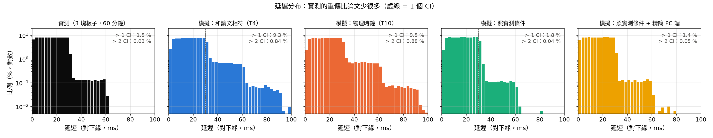
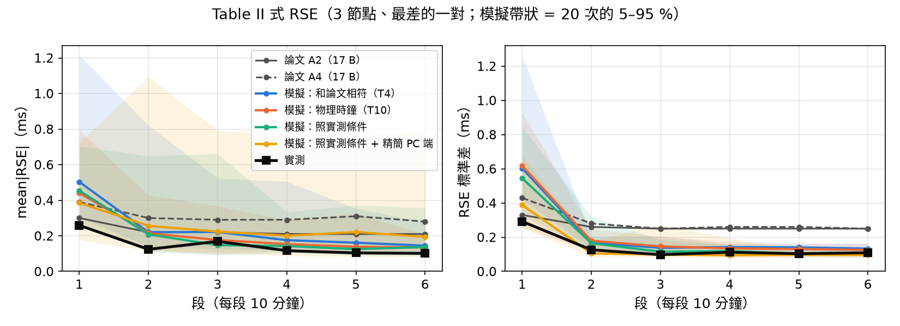

# T14　實測（3 塊 STM32 藍牙板）和哪一組模擬比較像？

**實測**：`Hands_on/`（3 塊 B-L475E-IOT01A、PC 內建藍牙 + bleak、Windows QueryPerformanceCounter、20 B、CI 30 ms）。
原始資料複製到 `data/hardware/`：`20261101_214202`（10 分鐘）, `20261101_220025`（60 分鐘）。
兩次都沒有掉包、沒有斷線。下表用 60 分鐘那次。

**模擬**（`config/T14_hardware.yaml`，各 20 次 × 3600 s × 3 節點；SharkTooth 都用「保留 α、β + 預傾斜 100 ppm」，和 `st_analyze.py` 的預設一樣）：

| 模擬 | 設定 |
|---|---|
| 和論文相符（T4） | T4 原樣：A8 −248 ppm、PC 理想、封包間隔 100.78 ms、重傳 7.9 % + 突發、起始等待 102 ms、244 B |
| 物理時鐘（T10） | 同上，但時鐘只有物理誤差：A8 = 0、PC ±50 ppm（= T10 的 physical、T11 的 exact + qpc） |
| 照實測條件 | 只填實測的已知條件：A8 = 0（傳原始 tick）、PC ±50 ppm、封包間隔 98.85–99.18 ms、20 B、無起始等待；獨立重傳 1.2 %（用實測反推）。PC 端延遲仍是 T4 擬合的（dongle、序列化、OS） |
| 照實測條件 + 精簡 PC 端 | 再拿掉實測沒有的層：nRF dongle 與 Blatann 序列化、GIL；OS 延遲 0.1 ms、韌體打包抖動（B2）關掉；重傳 1.4 %。**這幾項是看實測的延遲分布調的** |

## 1. δT 與延遲的特徵

模擬欄是 60 個節點的中位數（5–95 %）。✔ = 實測（3 節點的中位數）落在這組模擬的 5–95 % 內；
斜率用模擬的全部範圍（三塊板子共用同一台 PC，不是三個獨立抽樣）。

| 特徵 | 實測（A / B / C） | 模擬：和論文相符（T4） | 模擬：物理時鐘（T10） | 模擬：照實測條件 | 模擬：照實測條件 + 精簡 PC 端 |
|---|---|---|---|---|---|
| δT 斜率（ppm） | -44 / -47 / -34 | 251（231 ～ 267） | ✔ 12（-42 ～ 45） | ✔ 8（-37 ～ 49） | ✔ 9（-43 ～ 48） |
| 封包間隔（ms） | 98.91 / 99.18 / 98.85 | 100.77（100.74 ～ 100.77） | 100.77（100.77 ～ 100.77） | ✔ 99.03（98.91 ～ 99.15） | ✔ 99.00（98.88 ～ 99.15） |
| 延遲 P10（ms） | 3.5 / 3.6 / 3.6 | 5.2（4.9 ～ 5.3） | 5.1（5.0 ～ 5.4） | 4.9（4.7 ～ 5.1） | ✔ 3.6（3.5 ～ 3.6） |
| 延遲 P50（ms） | 15.6 / 15.8 / 15.8 | 18.4（18.1 ～ 18.6） | 18.4（18.2 ～ 18.6） | 17.1（16.9 ～ 17.3） | ✔ 15.7（15.7 ～ 15.8） |
| 延遲 P90（ms） | 27.8 / 27.9 / 28.0 | 31.9（31.6 ～ 32.2） | 31.9（31.7 ～ 32.2） | 29.2（29.0 ～ 29.4） | ✔ 27.9（27.9 ～ 28.0） |
| 延遲 P99（ms） | 40.9 / 38.4 / 44.5 | 61.4（60.8 ～ 62.1） | 61.4（60.9 ～ 61.9） | 39.1（37.4 ～ 40.8） | ✔ 40.9（39.3 ～ 42.0） |
| > 1 CI（%） | 1.38 / 1.40 / 1.81 | 9.32（9.05 ～ 9.71） | 9.32（9.04 ～ 9.64） | 1.81（1.65 ～ 2.05） | ✔ 1.41（1.33 ～ 1.49） |
| > 2 CI（%） | 0.044 / 0.017 / 0.033 | 0.870（0.758 ～ 0.950） | 0.860（0.750 ～ 0.927） | 0.050（0.036 ～ 0.066） | ✔ 0.047（0.028 ～ 0.066） |
| σ100（ms） | 14.67 / 14.68 / 14.86 | 19.37（19.19 ～ 19.50） | 19.36（19.19 ～ 19.52） | ✔ 14.65（14.56 ～ 14.73） | ✔ 14.72（14.62 ～ 14.83） |
| 起始尖峰（前 3 包最大，ms） | 21 / 24 / 11 | 123（106 ～ 138） | 119（105 ～ 133） | 27（22 ～ 32） | ✔ 26（21 ～ 31） |
| 下緣粗糙度（ms） | 1.19 / 1.31 / 1.40 | 2.64（2.49 ～ 2.77） | 2.51（2.37 ～ 2.64） | 2.44（2.33 ～ 2.83） | ✔ 1.29（1.18 ～ 2.59） |

落在範圍內的特徵數（共 11 項）：和論文相符（T4） 0、物理時鐘（T10） 1、照實測條件 3、照實測條件 + 精簡 PC 端 11。
物理時鐘的模擬中，δT 斜率範圍 -54～53 ppm，38 % 的節點是負的；和論文相符的設定做不出負斜率。

## 2. Table II 式 RSE（Eq.23–27，3 節點中最差的一對，ms）

實測與模擬用同一個函式（`evaluate.paper_rse`，互相關解析度 0.1 ms）。模擬的量測模型是 V1（只有時間誤差，沒有 ADC 雜訊與 AFE 差），因為實測的訊號直接進 ADC、沒有 AFE。
模擬是 20 次的中位數；實測只有 1 次。

| | | 1 | 2 | 3 | 4 | 5 | 6 |
|---|---|---|---|---|---|---|---|
| **實測**（20 B、3 節點、1 次） | mean|RSE| | 0.26 | 0.12 | 0.17 | 0.12 | 0.10 | 0.10 |
| 模擬：和論文相符（T4） | mean|RSE| | 0.50 | 0.22 | 0.22 | 0.18 | 0.16 | 0.14 |
| 模擬：物理時鐘（T10） | mean|RSE| | 0.44 | 0.22 | 0.18 | 0.15 | 0.14 | 0.13 |
| 模擬：照實測條件 | mean|RSE| | 0.45 | 0.21 | 0.15 | 0.14 | 0.13 | 0.14 |
| 模擬：照實測條件 + 精簡 PC 端 | mean|RSE| | 0.39 | 0.26 | 0.22 | 0.20 | 0.22 | 0.19 |
| 論文 A2（17 B、2 節點） | mean|RSE| | 0.30 | 0.22 | 0.22 | 0.21 | 0.21 | 0.21 |
| 論文 A4（17 B、4 節點） | mean|RSE| | 0.39 | 0.30 | 0.29 | 0.29 | 0.31 | 0.28 |
| **實測**（20 B、3 節點、1 次） | std | 0.29 | 0.13 | 0.10 | 0.11 | 0.10 | 0.11 |
| 模擬：和論文相符（T4） | std | 0.60 | 0.17 | 0.14 | 0.14 | 0.14 | 0.13 |
| 模擬：物理時鐘（T10） | std | 0.62 | 0.18 | 0.15 | 0.13 | 0.13 | 0.13 |
| 模擬：照實測條件 | std | 0.54 | 0.16 | 0.11 | 0.12 | 0.10 | 0.10 |
| 模擬：照實測條件 + 精簡 PC 端 | std | 0.39 | 0.11 | 0.10 | 0.09 | 0.10 | 0.10 |
| 論文 A2（17 B、2 節點） | std | 0.33 | 0.26 | 0.25 | 0.25 | 0.25 | 0.25 |
| 論文 A4（17 B、4 節點） | std | 0.43 | 0.28 | 0.25 | 0.26 | 0.26 | 0.25 |

## 結論

1. **現有的模擬沒有一組和實測一樣**：和論文相符（T4）、物理時鐘（T10）都是 0–1 / 11 項。
   只填已知條件（照實測條件）是 3 項；再拿掉實測沒有的 dongle 序列化層、縮小 PC 端與韌體抖動（照實測條件 + 精簡 PC 端）是 11 項。
   不需要新的變因，只是現有變因換成實測的值。
2. **時鐘像 T10 / T11 的「物理時鐘」，不像論文**：
   - 實測 δT 斜率 −34～−47 ppm（三塊都往下），論文 +235～+245 ppm。實測傳原始 tick、在 PC 上用 32768 精確換算，所以沒有 A8 換算誤差。
     這支持 T10 / T11：論文的 +240 ppm 不是晶振和 PC 時鐘本身做得出來的。
   - 三塊之間只差 13 ppm，共同部分約 −42 ppm。一般 32.768 kHz 晶振只有 ±20 ppm，所以共同部分至少一半來自 PC 時鐘（QPC）。
   - 斜率往下時論文字面版的 SharkTooth 會失效（T7、T10 的預測）；實測要加預傾斜 100 ppm 才正常輸出，和預測一致。
3. **延遲像論文 Fig.3（最安靜的那張），不像 Fig.6**：
   - 帶寬 = 1 個 CI（30 ms），σ100 約 14.7 ms，和 Fig.3（14.2–14.8 ms）一樣。
   - 重傳約 1.4 %（論文 Fig.6 的設定是 7.9 % 再加突發），而且是獨立的：> 2 CI 只有 0.03 %，獨立重傳 1.4 % 的模擬就是這個值，不需要 T3 / T4 的突發干擾。
   - **沒有起始尖峰和 −40 ms/包 的斜坡**（論文 Fig.6 有，T4 用「第一包等 102 ms + 韌體流量控制」解釋）。所以 C11 起始等待是論文的韌體或連線流程特有的，不是 BLE 一定會有。
   - 等待之外的延遲很小：P10 3.5 ms，純等待（0–30 ms 均勻）是 3.0 ms，只多約 0.5 ms；下緣粗糙度 1.3 ms（論文 Fig.6 約 2.1 ms）。
     T4 的 PC 端延遲（dongle、序列化、OS 合計約 1–2 ms）和 B2 韌體打包抖動（0.2–2 ms，依論文的 FreeRTOS 假設）都比實測大。
     實測用 PC 內建藍牙，沒有 nRF dongle 和 Blatann 的序列化層。
   - 封包間隔 98.9–99.2 ms（比 100 ms 短），論文 100.6–100.9 ms（比 100 ms 長）。兩者都是取樣計時器不是晶振造成的（T0），只是方向不同。
4. **同步誤差**：
   - 實測第 2–6 段 mean|RSE| 0.10–0.17 ms、std 0.10–0.13 ms，
     落在 20 次 5–95 % 內的模擬：照實測條件、照實測條件 + 精簡 PC 端；和論文相符（T4）、物理時鐘（T10） 有幾段實測低於下界。
     各組的範圍重疊很多，1 次錄音分不出是哪一組。
   - 比論文 A2 / A4（0.21–0.31 ms、std 約 0.25 ms）小。T6 的拆解：論文穩態的 std 幾乎全是量測雜訊（AFE、EMG 前端），實測訊號直接進 ADC，沒有這部分。
   - 實測第 1 段 0.26 ms，比四組模擬的中位數（0.39–0.50 ms）都低。
     T6 / T13 也看到模擬的第 1 段比論文高。實測也比模擬低，表示模擬的起始收斂可能比實際慢，而不是論文的實驗特別好。
   - 照實測條件 + 精簡 PC 端的第 2–6 段中位數（約 0.22 ms）反而比照實測條件（約 0.14 ms）大，而且是節點之間的固定偏差（真值版也一樣），20 次中最差的到 1.09 ms。
     原因【推測】：延遲很乾淨時，下緣只由少數幾個相位決定（99 ms 的封包 10 包約等於 33 個 CI，相位繞得很慢），各節點的下緣高度會差一點。實測這次沒有出現，要多錄幾次才知道。

## 限制

- 實測只有 1 次 60 分鐘的錄音；論文每個配置是 20 次的中位數。要比 IQR 或判斷第 4 點最後一項，需要多錄幾次。
- 實測的 RSE 沒有真值，只能用論文的方法（5 Hz 正弦）量；模擬另有真值版（`summary.json` 的 `true`）。
- 重傳率是用實測反推的，所以 > 1 CI、σ100 對上是預期中的。照實測條件 + 精簡 PC 端的 PC 端與韌體設定也是看實測的分布調的。
  **沒有調、直接對上的**：封包間隔、> 2 CI（突發與否）、起始尖峰、斜率的正負與大小範圍。
